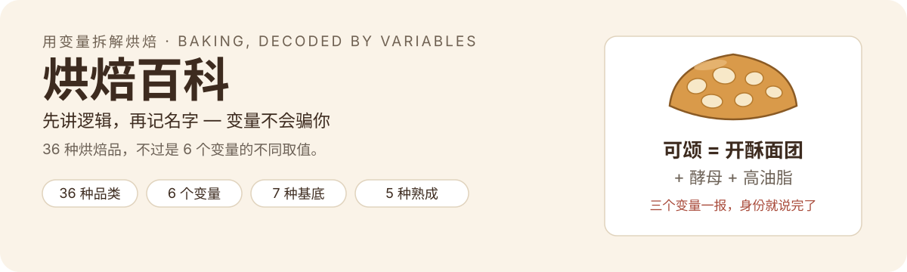

<p align="right"><a href="README.md">中文</a></p>

<p align="center">
  
</p>

<p align="center">
  <a href="https://holynova.github.io/baking-encyclopedia/">▶ Try Online</a>
  ·
  <a href="https://github.com/holynova/baking-encyclopedia">GitHub Repository</a>
</p>

Baking Encyclopedia teaches the logic before the names. It breaks 36 classic baked goods into 6 variables, 7 bases, and 5 cooking methods, so you can look up any item the way a programmer checks a variable: pick the base, see the leavening, compare the fat. Includes a variable lookup station, category filters, four head-to-head comparisons of easily confused items, and 36 photos.

## Screenshots

<p align="center">
  
</p>

<p align="center">
  
</p>

## The 6 Variables

| Variable | Values | Answers the question |
| --- | --- | --- |
| 基底 Base | 精简面团 lean dough / 油润面团 enriched dough / 开酥面团 laminated dough / 面糊 batter / 烫面团 scalded dough / 酥粒面团 crumb dough / 蛋白霜糊 meringue batter (7 kinds) | What is it made of? |
| 膨松 Leavening | 酵母 yeast / 天然酵种 natural starter / 化学膨松 chemical leavening (baking powder) / 蛋液打发 whipped eggs / 蒸汽 steam / 无 none | Where does the air inside come from? |
| 油脂 Fat | 无 none / 少量 low / 中等 medium / 高 high | How "rich" is the recipe? |
| 熟成 Cooking method | 烘烤 baking / 平底烙 griddle / 先煮后烤 boil-then-bake / 免烤冷藏 no-bake chilled / 烤后组装 bake-then-assemble (5 kinds) | How is it finished? |
| 门类 Category | 面包 bread / 蛋糕 cake / 酥点 pastry | Judged by form and use (an independent variable — it can't be derived) |
| 产地 Origin | Only decides the name | Names are the least reliable part; variables are the reliable part |

Two examples: a **croissant** = laminated dough + yeast + high fat (the base decides the technique: butter folded into 27 layers; the leavening decides the crumb: yeast gas opens the honeycomb). A **chiffon** = batter + whipped eggs + medium fat (all the lift comes from meringue, and it uses vegetable oil instead of butter, so it stays moister and less dry than a sponge cake).

## What's Inside

- **第一课 · 声明变量 (Lesson 1 · Declare Variables)**: the 6 variables are the "type system" of the baking world; every entry assigns one value to each variable.
- **第二课 · 变量查询台 (Lesson 2 · Variable Lookup Station)**: combine variable values yourself and see which bakes match — impossible combinations are called out as pairings nobody uses in real life.
- **词条库 (Entry Library)**: 36 entries, each with a photo, original name and origin country, variable values, and a one-line note; group by category, leavening, dough type, or country/region (GROUP BY), with search.
- **变量矩阵总表 (Variable Matrix)**: all 36 × 6 variables in one table — read a row for a complete definition, scan a column to see who shares a value; click any row for details.
- **第三课 · 名字解码 (Lesson 3 · Name Decoding)**: common roots and affixes, breaking strange names apart.
- **第四课 · 易混淆对决 (Lesson 4 · Head-to-Head Duels)**: English vs American muffin, sponge vs chiffon vs pound cake, New York vs Basque cheesecake, baguette vs ciabatta — compared variable by variable.

## Run Locally

A single `index.html`, no build, no dependencies:

```bash
python3 -m http.server
# Open http://localhost:8000/, or just double-click index.html
```

## Tech

- Single-file static site: `index.html` (structure + styles + data + interaction all inside); the 36 photos live in `assets/img/`.
- Entry data is a JS array (36 entries, each with one value per variable: base / leavening / fat / cooking method / category / origin); the lookup station, grouping, search, matrix table, and duels are all computed in the browser, no backend.

```
index.html          Everything: variable lessons / lookup station / library / matrix / decoding / duels
assets/img/         36 photos of baked goods
```
