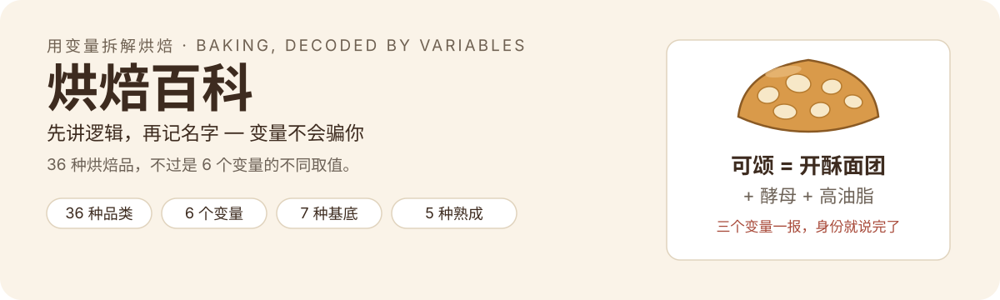

<p align="center">
  
</p>

<p align="center">
  <a href="https://holynova.github.io/baking-encyclopedia/">▶ 在线体验 Try Online</a>
  ·
  <a href="https://github.com/holynova/baking-encyclopedia">GitHub 仓库</a>
</p>

烘焙百科先讲逻辑、再记名字：把 36 种经典烘焙品拆解成 6 个变量、7 种基底、5 种熟成方式，像查变量一样查烘焙——选基底、看膨松、比油量，名字再怪也不怕。内置变量查询台、品类筛选、四组易混淆对决与 36 张实拍图。

Baking Encyclopedia teaches the logic before the names. It breaks 36 classic baked goods into 6 variables, 7 bases, and 5 cooking methods, so you can look up any item the way a programmer checks a variable: pick the base, see the leavening, compare the fat. Includes a variable lookup station, category filters, four head-to-head comparisons of easily confused items, and 36 photos.

## 截图 / Screenshots

<p align="center">
  
</p>

<p align="center">
  
</p>

## 6 个变量 / The 6 Variables

| 变量 | 取值 | 问什么 |
| --- | --- | --- |
| 基底 base | 精简面团 / 油润面团 / 开酥面团 / 面糊 / 烫面团 / 酥粒面团 / 蛋白霜糊（7 种） | 它是用什么做的 |
| 膨松 leaven | 酵母 / 天然酵种 / 化学膨松（泡打粉）/ 蛋液打发 / 蒸汽 / 无 | 里面的气从哪来 |
| 油脂 fat | 无 / 少量 / 中等 / 高 | 配方有多「富」 |
| 熟成 heat | 烘烤 / 平底烙 / 先煮后烤 / 免烤冷藏 / 烤后组装（5 种） | 最后怎么定型 |
| 门类 cat | 面包 / 蛋糕 / 酥点 | 看形态与用途（独立变量，推不出来） |
| 产地 origin | 只负责命名 | 名字最不可靠，变量最可靠 |

举两个例子：**可颂** = 开酥面团 + 酵母 + 高油脂（基底决定工艺：裹油折叠 27 层；膨松决定内部：酵母产气撑开蜂窝）；**戚风** = 面糊 + 蛋液打发 + 中等油脂（气全靠蛋白霜，用植物油而非黄油，所以比海绵蛋糕湿润不噎人）。

## 站内内容 / What's Inside

- **第一课 · 声明变量**：6 个变量就是烘焙世界的「类型系统」，每个词条都是给 6 个变量各赋一个值。
- **第二课 · 变量查询台**：自己组一组变量取值，看命中哪些烘焙品；不存在的组合会明确告诉你现实中没人这么搭。
- **词条库**：36 种品类，每张卡片带实拍图、原名与来源国、变量取值与一句话解读；可按门类 / 膨松原理 / 面团形态 / 国家地区分组（GROUP BY），可搜索。
- **变量矩阵总表**：36 种 × 6 个变量一张表看全，横读一行是完整定义，竖扫一列看谁共享同一取值；点任意一行打开词条详情。
- **第三课 · 名字解码**：高频词根词缀，拆开怪名字的构成。
- **第四课 · 易混淆对决**：英式马芬 vs 美式马芬、海绵 vs 戚风 vs 磅蛋糕、纽约芝士 vs 巴斯克芝士、法棍 vs 恰巴塔——逐变量对照。

## 本地运行 / Run Locally

单个 `index.html`，无构建、无依赖：

```bash
python3 -m http.server
# 打开 http://localhost:8000/，或直接双击打开 index.html
```

## 技术 / Tech

- 单文件静态站：`index.html`（结构 + 样式 + 数据 + 交互全在里面），36 张图片在 `assets/img/`。
- 词条数据是 JS 数组（36 条，每条含基底 / 膨松 / 油脂 / 熟成 / 门类 / 产地 6 个变量值）；查询台、分组、搜索、矩阵表、对决均为前端即时计算，无后端。

```
index.html          全部内容：变量课 / 查询台 / 词条库 / 矩阵表 / 解码 / 对决
assets/img/         36 张烘焙品实拍图
```

## English

**Baking Encyclopedia** teaches logic before names: 36 classic bakes decoded into 6 variables — base (7 kinds), leavening, fat, cooking method (5 kinds), category, and origin. Each entry assigns one value per variable, so a strange name stops being a mystery: a croissant is laminated dough + yeast + high fat; a chiffon is batter + whipped eggs + medium fat.

- **Variable lookup station**: combine variable values yourself and see which bakes match — impossible combinations are called out.
- **Library**: 36 entries with photos, original names, origins, and variable values; group by category, leavening, dough type, or country; full-text search.
- **Matrix table**: all 36 × 6 variables in one table; click any row for details.
- **4 head-to-head duels**: English vs American muffin, sponge vs chiffon vs pound cake, New York vs Basque cheesecake, baguette vs ciabatta.
- **Run it**: single-file static site — `python3 -m http.server`, or just open `index.html`.
